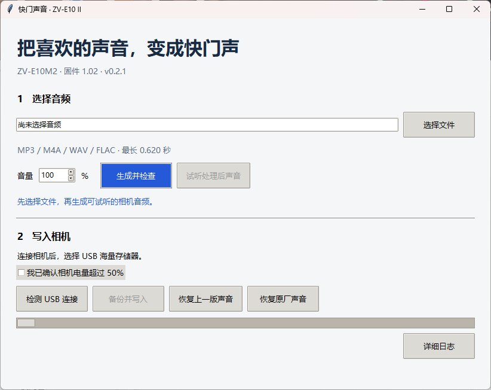

# ZV-E10M2 快门声音工具 v0.3.0

在 Windows 上生成、试听和写入自定义快门音，也可以恢复上一个声音或原厂声音。

[详细使用说明](使用说明.md) · [配置示例](config.example.json) · [原厂恢复离线测试](factory_verification.json)

## 适用范围

适用于 Sony ZV-E10M2 固件 1.02，以及工具已记录和核验的相机状态。程序会检查主程序、色彩程序、声音包和当前音频。相同机型和固件号仍需通过文件校验。

这是源码仓库。运行需要匹配的本地研究文件、相机备份、USB 服务工具和驱动。GitHub 的源码压缩包无法单独运行，详见使用说明中的环境配置。

## FL2／FL3 创意外观

点击软件右上角「FL2／FL3 外观」可从匹配的原始备份生成两套外观文件。成像差分和命令行用法见 [FL2／FL3 外观数据](filters/README.md)。

## 快速上手

1. 选择最长 0.620 秒的 MP3、M4A、WAV 或 FLAC，设置音量。
2. 点击「生成并检查」，再点「试听处理后声音」。
3. 相机选择 USB 海量存储器模式，接好数据线。确认电量超过 50%，再点「备份并写入」。
4. 等待写入并回读成功。拔线、关机，等读写灯熄灭后取出电池约一分钟，重新开机拍照试听。

v0.2.1 将过程输出收进「详细日志」，主界面显示操作状态和错误。检测到异常时，保留备份和未完成记录，按使用说明排查。

机主已在一台 ZV-E10M2 1.02 上验证自定义换音和恢复原厂声音。两项操作均在重启后通过拍照试听。
