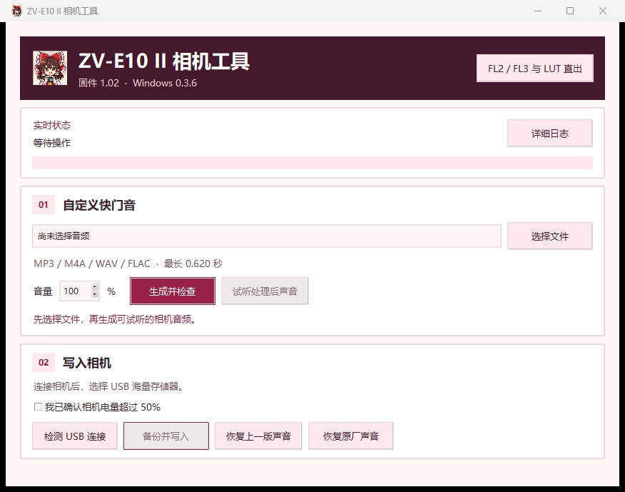
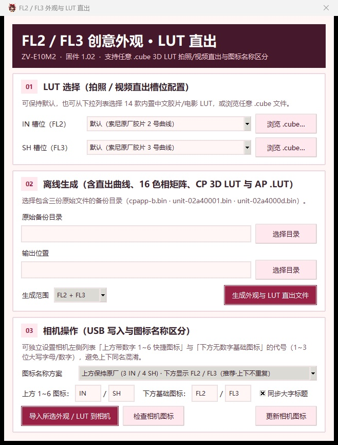

# ZV-E10M2 快门声音工具 v0.3.6

在 Windows 上生成、试听和写入自定义快门音，也可以恢复上一个声音或原厂声音。v0.3.6 新增 `.cube` 3D LUT 直出和创意外观图标名称自定义。

[详细使用说明](使用说明.md) · [配置示例](config.example.json) · [原厂恢复离线测试](factory_verification.json)

## 安卓测试版

[下载 0.2.9 公开 APK](android/downloads/ZVE10-II-Android-0.2.9-public.apk) · [安卓使用说明和源码](android/README.md)

公开版可处理快门音、生成 FL2／FL3 外观文件和检测 USB。通过服务模式备份、写入快门音、导入外观及更新相机图标需要带本地资源的构建。

安卓 0.2.9 本地构建支持从 14 款内置 LUT 或手机里的 `.cube` 为 IN／SH 各选一款，再转换并导入相机。模板包包含自定义快门音、FL2／FL3、LUT 预设与自选转换，以及相机图标的写入和恢复资源。 [14 款 LUT 文件](android/luts) · [下载模板包](android/downloads/ZVE10-II-Android-0.2.8-templates.zip)

## 适用范围

适用于 Sony ZV-E10M2 固件 1.02，以及工具已记录和核验的相机状态。程序会检查主程序、色彩程序、声音包和当前音频。相同机型和固件号仍需通过文件校验。

这是源码仓库。运行需要匹配的本地研究文件、相机备份、USB 服务工具和驱动。GitHub 的源码压缩包无法单独运行，详见使用说明中的环境配置。

## FL2／FL3 创意外观

点击软件右上角「FL2／FL3 外观」可从匹配的原始备份生成两套外观文件。同一窗口也可以将已核对的两套外观导入匹配的相机。成像差分和用法见 [FL2／FL3 外观数据](filters/README.md)。

Windows 0.3.4 新增左侧图标检查和更新，覆盖 `23_IPSX` 与 `32_IPSX` 两套资源。机主已确认更新后左侧 FL2／FL3 显示正常。安卓 0.2.5 本地测试版使用同一套资源，安卓图标写入待实机验证。

## LUT 直出（v0.3.6）

在「FL2／FL3 与 LUT 直出」窗口的 `01 LUT 选择` 中，IN（FL2）和 SH（FL3）两个槽位可以各自保持索尼原厂曲线，或选择任意 `.cube` 3D LUT。工具会把 LUT 换算为相机原生的色调曲线、16 色相矩阵、CP 3D LUT 单元和 AP `.LUT` 文件，JPEG／HEIF 和视频可直接出片。

内置 14 款中文命名的胶片／电影风格 LUT（富士经典正片、柯达复古金、日系清新镰仓蓝、好莱坞电影青橙、徕卡高反差黑白等），首次打开窗口时自动生成到 `filters/luts/`。

> 提示：原机 IN 默认「褪色 3」、SH 默认「褪色 6」，会冲淡 LUT 效果。拍摄前可在创意外观微调栏把「褪色」改为 0。

## 图标名称自定义（v0.3.6）

创意外观列表的上方「1～6 自定义快捷位」和下方基础外观共用同一底层槽位，原先会同时显示 `FL2`／`FL3`，看起来像重复。`03 相机操作` 现在可以分别设置：

- 上方带数字的 1～6 快捷图标代号
- 下方无数字的基础图标代号
- 是否同步屏幕中央的橙色大字标题

内置方案包括「上方保持 IN／SH · 下方 FL2／FL3」（推荐）、「上方 L1／L2」「全部恢复原厂」等，也可以自由填写 1～3 位大写字母或数字。工具会从相机当前图标状态出发，只写入不同的槽位。每批写入程序都会先做 30 项 ARM64 指令级仿真，并完整备份。

## 快速上手

1. 选择最长 0.620 秒的 MP3、M4A、WAV 或 FLAC，设置音量。
2. 点击「生成并检查」，再点「试听处理后声音」。
3. 相机选择 USB 海量存储器模式，接好数据线。确认电量超过 50%，再点「备份并写入」。
4. 等待写入并回读成功。拔线、关机，等读写灯熄灭后取出电池约一分钟，重新开机拍照试听。

主窗口顶部显示实时状态，可在旁边展开「详细日志」。检测到异常时，保留备份和未完成记录，按使用说明排查。

机主已在一台 ZV-E10M2 1.02 上验证自定义换音和恢复原厂声音。两项操作均在重启后通过拍照试听。
