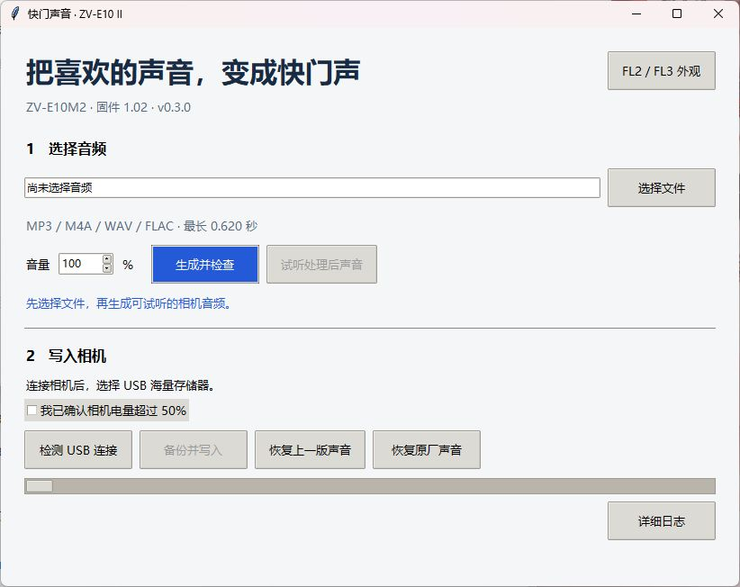

# 使用说明



## 1. 准备运行环境

已安装工具的电脑可以从桌面快捷方式启动。关闭旧窗口后重新打开，程序会重新读取配置。

从 GitHub 取得源码后，需要在 Windows 上准备 Python（含 tkinter）、FFmpeg、Zig、支持本机相机的 Sony 服务工具与 USB 驱动，以及与相机当前状态匹配的本地研究文件和备份。仓库没有包含相机固件、个人音频、设备备份或驱动。

将 `config.example.json` 复制为 `config.json`，按下表填写实际路径。用正斜杠写 Windows 路径可以避免 JSON 反斜杠转义。

| 字段 | 填写内容 |
| --- | --- |
| `python` | 用来运行后端的 Python 可执行文件完整路径 |
| `research` | 原研究环境中的 `work/firmware_research` 目录 |
| `ffmpeg` | FFmpeg 可执行文件完整路径 |
| `toolkit` | 包含 `Sony-PMCA-RE` 的相机服务工具目录 |
| `zig` | Zig 可执行文件完整路径 |

`research` 目录需要保留已验证的程序基线、加载及写入程序源码、传输脚本和模拟测试文件。它的上一级目录也要保留原研究环境的结构，包括 `research_libs`、`full_audio`、`restore_v0_1`，以及原厂恢复所需的 `fl23_research/cp_worker_v1`。后端从 `toolkit/deps` 或所配置的 Python 环境加载工具依赖。需要 PyUSB、匹配的 libusb 和服务工具支持的驱动。离线模拟使用 Unicorn 和 pyelftools。

在仓库目录中运行：

```powershell
& 'D:/camera-env/.venv/Scripts/python.exe' gui.py
```

将命令中的 Python 路径换成实际路径。已有打包环境可用 PyInstaller 构建 `快门声音工具.spec`。生成的 EXE 应与 `backend.py`、`factory_sound.py`、`filter_install.py`、`filters` 目录和 `config.json` 放在同一目录，外部工具和研究文件继续由配置引用。

## 2. 生成并试听

1. 点「选择文件」，选取 MP3、M4A、WAV、FLAC、AAC 或 OGG。
2. 将音量设在 10%–100%，点击「生成并检查」。更改音量后需要重新生成。
3. 等待界面显示音频名称、时长和音量，再点「试听处理后声音」。

工具按实际解码的时长判断，最多支持 0.620 秒。超长时请先在音频编辑器里截取你想保留的片段。生成过程保留整段选定音频，转换为 24 kHz 单声道。试听使用相机编码后的音频，相机扬声器的实际响度和音色会有差异。

生成的配置、试听 WAV 和编码文件保存在工具目录下的 `sounds`。生成与试听可以离线完成。

## 3. 备份并写入

1. 确认相机电量超过 50%，相机开机后选择 USB 海量存储器模式，并用数据线连接电脑。
2. 点「检测 USB 连接」。这一步检查 Windows 是否识别到 Sony USB 设备，完整的机型和文件检查会在写入前执行。
3. 勾选电量确认，点「备份并写入」，在弹窗确认写入选定音频。
4. 等待「写入成功」。期间保持供电和 USB 连接。工具会先备份当前文件，写入后完整回读。
5. 拔掉 USB，关机并等读写灯熄灭，取出电池约一分钟。装回电池、开机并拍照试听。

下次进行相机操作时，重启相机并重新选择 USB 海量存储器连接。写入并回读成功说明文件核对通过，实际快门声音以断电重启后的拍照试听为准。

## 4. 恢复声音

| 按钮 | 恢复内容 |
| --- | --- |
| 恢复上一版声音 | 恢复上一次成功换音或恢复操作之前的声音与加载配置。需要工具保存的历史记录和对应音频。 |
| 恢复原厂声音 | 恢复原厂加载程序及声音包中的快门槽位。需要匹配的原厂备份及可用的相机服务连接。 |

恢复前同样需要电量超过 50%，并通过 USB 海量存储器连接。恢复完成后按写入步骤断电重启，拍照核对。原厂恢复针对快门声音，保留 FL2／FL3 色彩修改和其他设置。旧自定义声音文件会留在相机内部，以便切回。

## 5. 查看日志与处理异常

| 提示或现象 | 处理方法 |
| --- | --- |
| 「找不到指定的文件」 | 检查 `config.json` 中的 Python、FFmpeg、Zig 路径以及研究目录。修改配置后重新打开工具。 |
| 「未检测到 Sony USB 设备」 | 检查相机是否开机、USB 模式是否为海量存储器，以及线材是否支持数据传输。 |
| 音频超长或生成失败 | 确认音频可正常播放、实际解码长度不超过 0.620 秒，并展开「详细日志」查看错误。 |
| 相机状态或文件校验不一致 | 保存日志和报告，核对机型、固件和当前备份。需要匹配的本地基线才能继续。 |
| 写入中断或回读失败 | 保留 `pending.json` 和对应操作目录，先根据备份和报告核对相机状态。不要删除标记强行重试。 |

`operations` 保存每次操作的备份、报告和正反向写入程序。`current.json` 与 `previous.json` 记录当前和上一版声音，移动目录后应检查记录中的绝对路径。建议在相机正常时保存这些文件和对应的 `sounds` 目录。

写入更新相机内的加载程序，断电或写入故障可能导致无法开机。恢复要求相机仍能建立服务连接。无法开机时的独立恢复尚未验证。

## 6. 验证记录

v0.2.1 的界面已检查日志展开、收起、成功和失败提示。机主已在一台 ZV-E10M2 1.02 上验证自定义换音和恢复原厂声音。两项操作均在重启后通过拍照试听。历史模拟结果见 [factory_verification.json](factory_verification.json)。

## 7. 生成 FL2／FL3 外观文件

打开 v0.3.0 或更新版本，点击右上角「FL2／FL3 外观」。选择包含 `cpapp-b.bin`、`unit-02a40001.bin`、`unit-02a4000d.bin` 的匹配原始备份目录，再选输出位置。默认同时生成 FL2 和 FL3，也可在下拉框里只选一个。点击「生成外观文件」后，软件核对输入文件并把结果写入新目录。生成与核对在电脑上离线完成。有关适用基线和命令行用法，见 [外观数据说明](filters/README.md)。

## 8. 导入 FL2／FL3 到相机

v0.3.1 在「FL2／FL3 外观」窗口加入「导入两套到相机」。相机以 USB 海量存储器模式连接后，在主窗口勾选电量超过 50%，再进入外观窗口启动导入。两套数据使用已有的 IN／SH 入口，生成文件仍可单选。

等待软件完成备份和回读。重启后分别选择原 IN／SH 位置拍照核对。相机已经安装两套外观时，软件会核对并跳过。失败时从「详细日志」查看报告，保留备份和未完成标记。依赖和验证范围见 [外观数据说明](filters/README.md)。
